# UTS Pemrograman Web I — Portal Informasi Perusahaan & CRUD API

Repositori ini dibuat untuk memenuhi **Ujian Tengah Semester (UTS)** mata kuliah **Pemrograman Web I** di Universitas Teknologi Bandung, yang menggabungkan **Project 1 (Web Frontend)** dan **Project 2 (CRUD API PHP PDO)** dalam satu repositori.

## Identitas Mahasiswa
| Keterangan | Detail |
| :--- | :--- |
| **Nama Lengkap** | Ahmad Kurnia |
| **NIM / NPM** | 24552011297 |
| **Kelas** | TIF RP 24E CNS |
| **Semester** | 5 |
| **Mata Kuliah** | Pemrograman Web I |
| **Dosen Pengampu** | Nova Agustina, S.T., M.Kom. |

## Live Demo (GitHub Pages)
- **Website Project 1:** [https://ahmadkurnia13.github.io/uts-pemweb1-ahmadkurnia/](https://ahmadkurnia13.github.io/uts-pemweb1-ahmadkurnia/)
- **Akun Demo Login:** Username `ahmad` | Password `24552011297`

---

## Project 1 — Website Informasi Perusahaan (Bootstrap 5 + JavaScript)

### Fitur Utama
- **Desain Responsif** menggunakan Framework CSS **Bootstrap 5.3** & Bootstrap Icons.
- **Halaman Utama (`index.html`):** Menampilkan profil singkat dan kumpulan informasi perusahaan (dilengkapi filter kategori).
- **Halaman Detail Informasi (`detail.html`):** Menampilkan isi lengkap informasi sesuai kartu yang diklik di Halaman Utama (`detail.html?id=...`).
- **Halaman Login (`login.html`):** Validasi login dengan fungsi JavaScript menggunakan struktur percabangan `if / else if / else`. Jika valid, berpindah ke Halaman Menu Utama.
- **Halaman Registrasi (`register.html`):** Pendaftaran akun baru yang langsung tersimpan ke `localStorage` untuk dipakai login.
- **Halaman Menu Utama (`dashboard.html`):** Panel internal setelah berhasil login yang menampilkan ringkasan dan tabel data informasi perusahaan.
- **Footer Resmi** di seluruh halaman: `@Copyright by 24552011297_AHMAD KURNIA_TIF RP 24E CNS`.

### Screenshot Tampilan Website (Project 1)

#### 1. Halaman Utama Website (`index.html`)
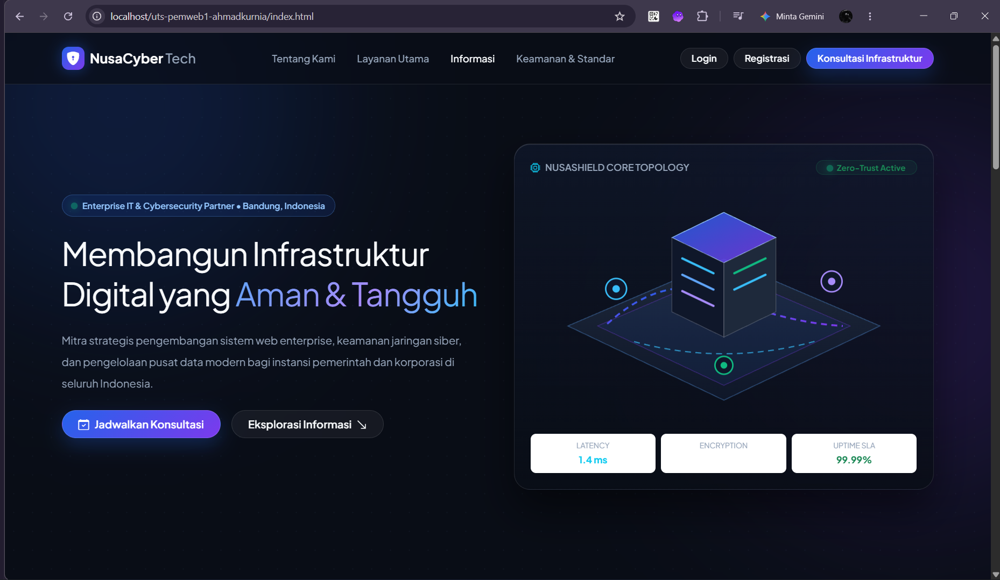

#### 2. Halaman Detail Informasi (`detail.html`)
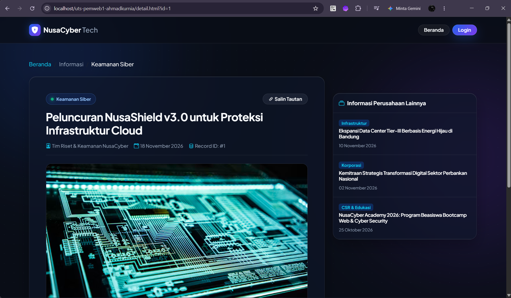

#### 3. Halaman Login (`login.html`)
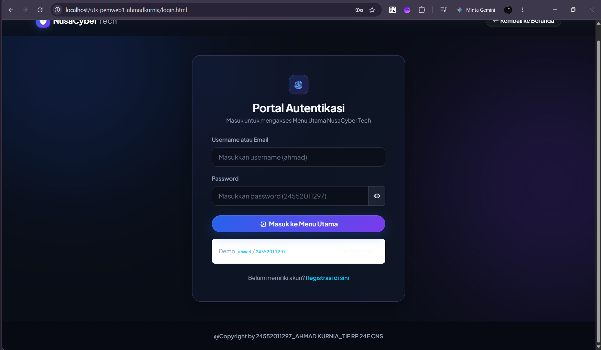

#### 4. Halaman Registrasi (`register.html`)
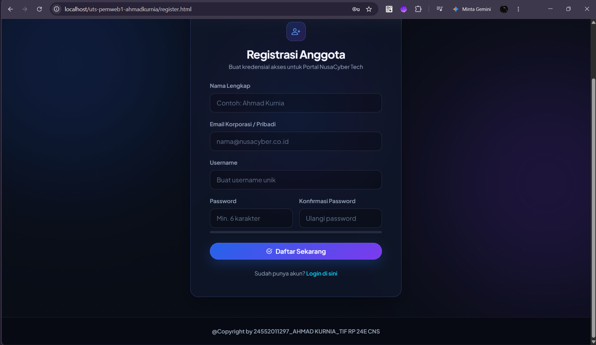

#### 5. Halaman Menu Utama Setelah Login (`dashboard.html`)
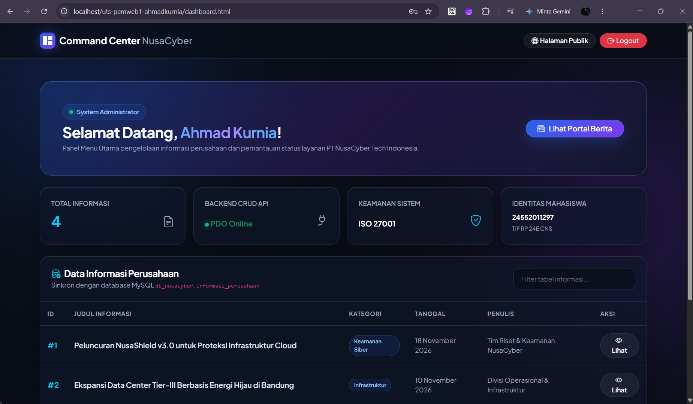

---

## Project 2 — CRUD API (PHP PDO + MySQL)

Backend REST API dibuat menggunakan **PHP PDO** dengan database MySQL (`db_nusacyber`, tabel `informasi_perusahaan`) yang datanya sinkron dengan data dummy Project 1.

### Daftar Endpoint API
| Fitur | Method | Endpoint (Localhost) | Body (`Multipart Form`) |
| :--- | :---: | :--- | :--- |
| **Test Koneksi** | `GET` | `http://localhost/uts-pemweb1-ahmadkurnia/api/koneksi/connection.php` | - |
| **Read Semua Data** | `GET` | `http://localhost/uts-pemweb1-ahmadkurnia/api/flow/get_data.php` | - |
| **Create (Insert)** | `POST` | `http://localhost/uts-pemweb1-ahmadkurnia/api/flow/insup_data.php` | `judul`, `kategori`, `tanggal`, `penulis`, `ringkasan`, `isi_lengkap`, `fileGambar` |
| **Update Data** | `POST` | `http://localhost/uts-pemweb1-ahmadkurnia/api/flow/insup_data.php` | `id`, `judul`, `kategori`, `tanggal`, `penulis`, `ringkasan`, `isi_lengkap`, `fileGambar` |
| **Delete Data** | `POST` | `http://localhost/uts-pemweb1-ahmadkurnia/api/flow/delete_data.php` | `id` |

### Hasil Pengujian API di Bruno / Postman (Project 2)

#### 1. Uji Koneksi Database (`GET connection.php`)
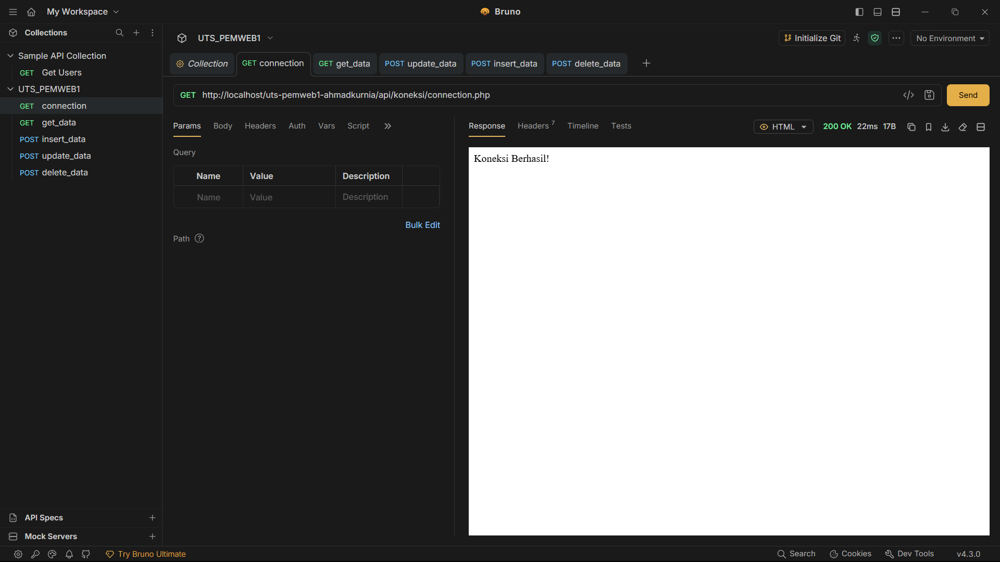

#### 2. Read Data (`GET get_data.php`)
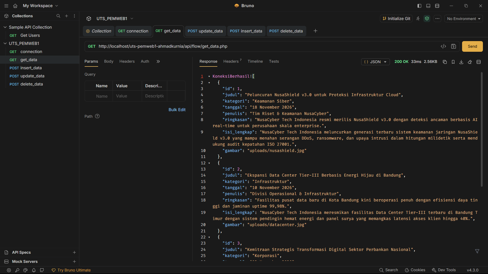

#### 3. Create / Insert Data (`POST insup_data.php` tanpa ID)
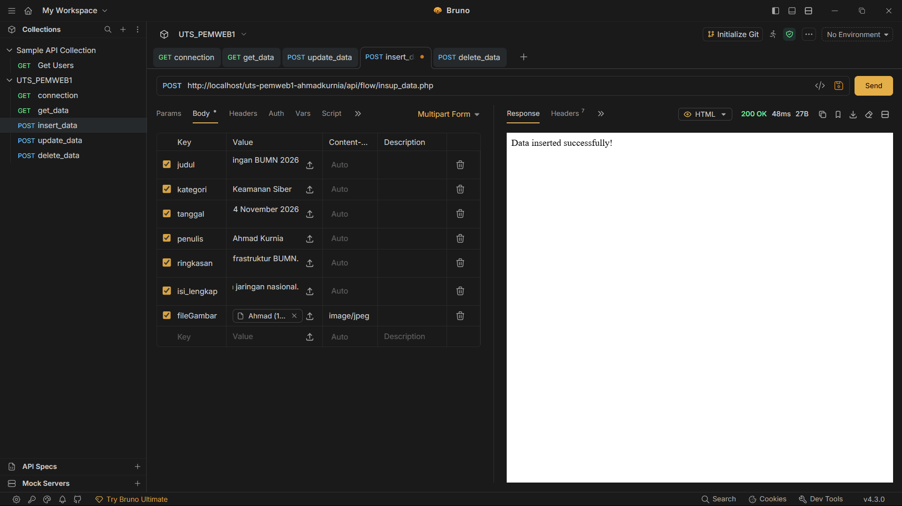

#### 4. SQL (`SQL DATA INSERT`)
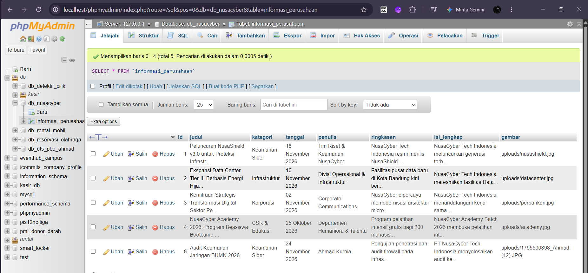

#### 5. Update Data (`POST insup_data.php` dengan ID)
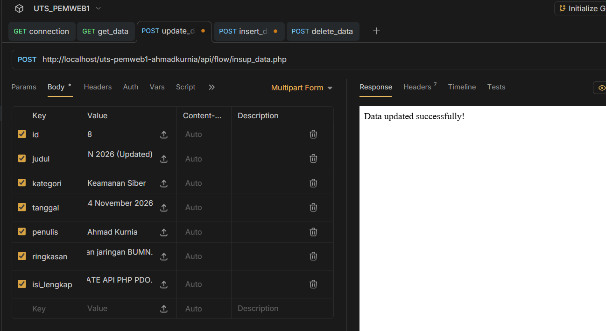

#### 6. Delete Data (`POST delete_data.php`)
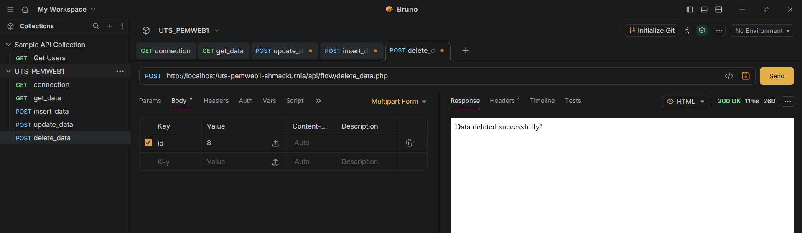

#### 7.SQL (`SQL DATA DELETE`)
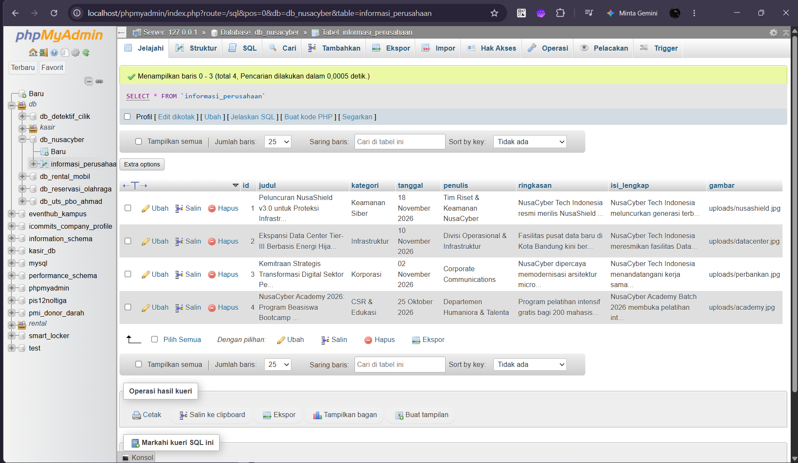

---

## Cara Menjalankan di Lokal (XAMPP)
1. Clone repositori ini ke folder `C:\xampp\htdocs\uts-pemweb1-ahmadkurnia`.
2. Jalankan **Apache** dan **MySQL** di XAMPP Control Panel.
3. Buka `http://localhost/phpmyadmin`, pilih tab **Import**, lalu pilih file `database/uts_pemweb1.sql` dan klik **Go**.
4. Akses website Project 1 di `http://localhost/uts-pemweb1-ahmadkurnia/`.
5. Uji endpoint Project 2 menggunakan **Bruno** atau **Postman** sesuai tabel endpoint di atas.

---
**@Copyright by 24552011297_AHMAD KURNIA_TIF RP 24E CNS**